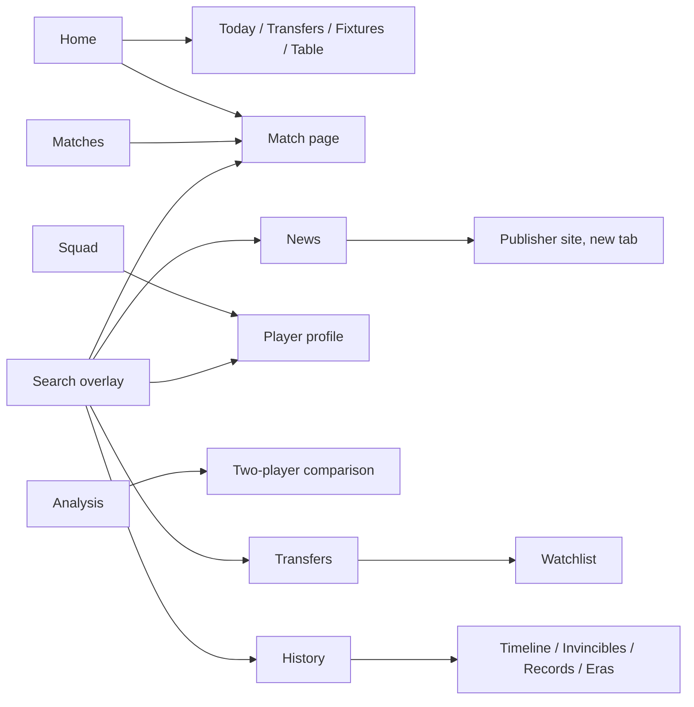

# User guide

[Wiki home](../README.md) · [Features and capabilities](features-and-capabilities.md)

## Contents

- [Getting around](#getting-around)
- [Main journeys](#main-journeys)
- [Your data](#your-data)
- [Reading the labels](#reading-the-labels)

## Getting around

On wide screens (1024px and up) all sections are in the header. On smaller screens a bottom bar shows Home, News, Matches, Transfers and Squad; **More** holds Analysis and History.

Header buttons: search (or press `/`), refresh, and light/dark theme. Every page has its own address, so you can bookmark or share it.

## Main journeys

**Check today.** Open Home. The top card shows the next match (or the live or just-finished one); Today lists the top stories.

**Follow a story.** In News, filter by category, source or player, or search. Open a headline to read it at the publisher. Use the bookmark to save it.

**Look at a match.** Matches → choose a fixture or result. Before kick-off you can record a prediction. Afterwards you see events, statistics and lineups when ESPN publishes them.

**Check the squad.** Squad → filter by position or status → open a player. Use the star to follow them. Switch between Men's and Women's at the top.

**Compare players.** Analysis → pick two players from the same squad → choose season and competition.

**Track a transfer.** Transfers → open a timeline to see each report and its outlet → **Watch** to be told when the status changes or new reports appear.

## Your data

Saved articles, followed players, watchlist, predictions, filters, recent pages and theme are stored **only in this browser**. Clearing site data removes them. "Clear history" empties the recently visited list.

## Reading the labels

| Label | Meaning |
|---|---|
| Official / Journalist / Reliable / Secondary / Opinion | Weight of the **outlet**, not proof that a story is true |
| Reported complete | One reliable source reports completion |
| Confirmed | The club, or two independent reliable outlets, report completion |
| No injury reported | ESPN's list has no entry; not a club fitness statement |
| Unknown | The provider gave no usable injury data |
| Awaiting result | Kick-off was long ago but the provider still lists the match as scheduled |
| Last updated … | You are looking at saved data of that age |
