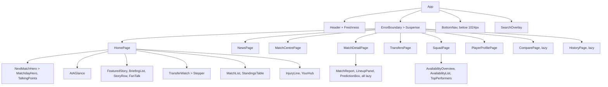

# Component architecture

[Wiki home](../README.md) · [Design system](design-system.md) · [Routing](routing-and-navigation.md)

## Component hierarchy

## Shared primitives (`src/components/ui.jsx`)

| Component | Use |
|---|---|
| `Panel`, `SectionHead` | Card surface and section title |
| `Chips`, `Select` | Filter tabs and labelled dropdowns |
| `SourceGate` | Chooses skeleton, error or content for a data source, and adds `StaleBanner` |
| `StaleBanner` | Age of cached data, or "Refresh failed" |
| `ErrorState`, `SectionError`, `EmptyState` | Failure and empty states |
| `Skel`, `SkeletonRows` | Loading placeholders |
| `Crest`, `Thumb`, `ArsenalMark` | Images with fallbacks |
| `ResultPill`, `CompBadge` | Result (W square, D circle, L diamond) and competition badge |
| `ErrorBoundary` | Keeps one broken page from blanking the app |
| `useNow`, `cx` | Clock hook (30s) and class joiner |

## Conventions

- Data state is a "source" object: `{ status, data, error, warnings, savedAt }`. Pass it to `SourceGate` rather than re-implementing loading and error handling.
- Pages receive data as props; only match detail, hero summary and player statistics fetch their own, and they subscribe to `useRefreshEpoch`.
- Cross-component imports exist (for example `PlayerAvatar` from `squad.jsx`, `TierBadge` from `news.jsx`). Reuse them.
