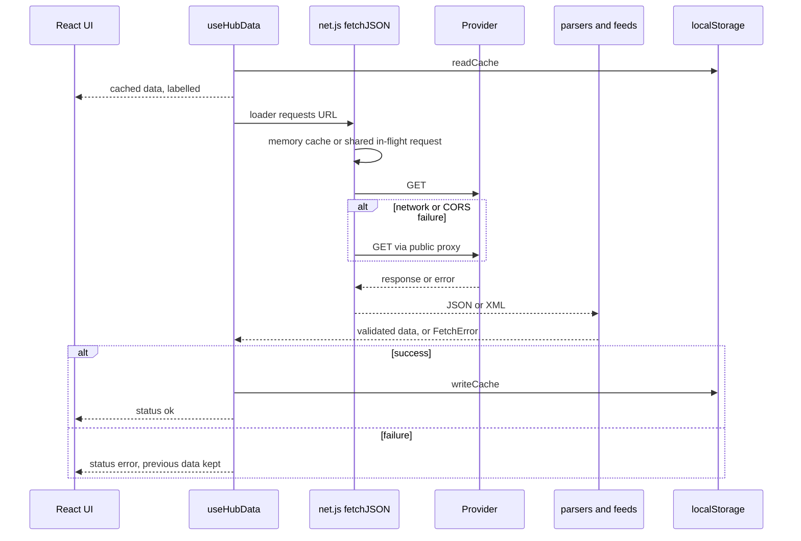

# Data flow

[Wiki home](../README.md) · [Caching and refresh](../04-data-and-integrations/caching-and-refresh.md) · [Error handling](../04-data-and-integrations/error-handling.md)

`External API → fetchJSON → parser/validator → source state → derived logic → UI`

## Retrieval and processing

## Sources and loaders

`LOADERS` in `src/lib/data.js` defines each independent source:

| Key | Content | Notes |
|---|---|---|
| `schedule` | Men's fixtures and results | Falls back to league-only schedule with a warning |
| `roster`, `standings` | Squad, table | |
| `team` | Team summary | Optional enrichment; never counted as a failure |
| `arsenalNews` | All Arsenal feeds plus ESPN news | Succeeds if any feed returns items; merged with the archive |
| `worldNews` | Premier League and Champions League news | |
| `womenRoster`, `womenSchedule`, `womenStandings` | Women's team | Lazy |

Match summaries, player statistics, player photos and transfer-target lookups are fetched on demand outside `LOADERS`.

## Derived data

`useIntelligence` (`App.jsx`):

1. `playerKeys(squad)` builds name-matching keys.
2. `buildStories(newsItems, { players })` enriches, filters for relevance, de-duplicates and ranks.
3. `namesToLookUp` → `lookupPlayers` finds possible incoming targets.
4. `buildTransfers(stories, …)` produces the transfer entries.

See [Data transformation](../04-data-and-integrations/data-transformation.md).
