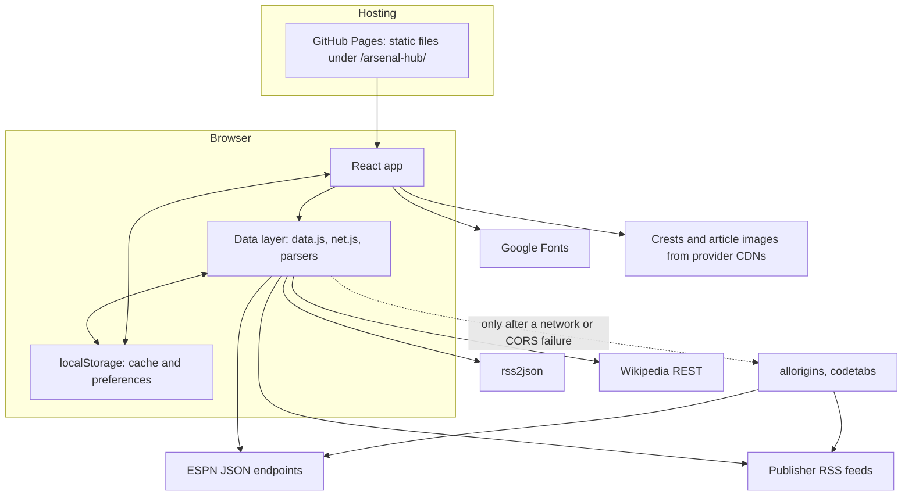

# System architecture

[Wiki home](../README.md) · [Application structure](application-structure.md) · [Data flow](data-flow.md)

## Contents

- [High level](#high-level)
- [Layers](#layers)
- [State management](#state-management)
- [External integrations](#external-integrations)
- [Deployment architecture](#deployment-architecture)

## High level

A static bundle served by GitHub Pages. All data work happens in the browser.

## Layers

| Layer | Responsibility | Where |
|---|---|---|
| Entry | Mounts `<App>` in React Strict Mode | `src/main.jsx` |
| Shell | Routing, theme, header, navigation, search, Home | `src/App.jsx` |
| Pages and UI | Feature pages and shared primitives | `src/components/` |
| Domain logic | Pure functions: news, transfers, match phase, standings, availability, pitch layout | `src/lib/` |
| Data access | Loading, validation, caching, network | `src/lib/data.js`, `net.js`, `parsers.js`, `feeds.js` |

Domain modules avoid React and the DOM where possible, so they are unit-testable. `parseRssXml` is the exception: it needs the browser's `DOMParser`.

## State management

There is no global store. `App` holds the shared state and passes it down as props:

| State | Hook | Persisted |
|---|---|---|
| Data sources (status, data, error, age) | `useHubData` (`data.js`) | `afc-cache-v2` |
| Derived stories and transfers | `useIntelligence` (`App.jsx`), memoised | no |
| Route | `useRoute` | the URL hash |
| Theme | `useDarkMode` | `afc-theme` |
| Filters and tabs | `usePersistentState("afc-prefs-v1")` | yes |
| Bookmarks, followed players, watchlist, predictions, recents | hooks in `storage.js` | yes |
| "Data was refreshed" signal | `refresh.js` (`useSyncExternalStore`) | no |

## External integrations

See [Data sources](../04-data-and-integrations/data-sources.md) and [API reference](../04-data-and-integrations/api-reference.md). None requires a key.

## Deployment architecture

Push to `main` → GitHub Actions → tests and build → Pages artifact → GitHub Pages. See [GitHub Actions](../06-deployment-and-operations/github-actions.md) for the diagram.
