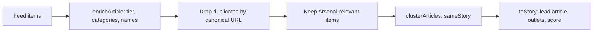

# News and content

[Wiki home](../README.md) · [Transfers](transfers.md) · [Data transformation](../04-data-and-integrations/data-transformation.md)

## Contents

- [Purpose and experience](#purpose-and-experience)
- [Functionality](#functionality)
- [How stories are built](#how-stories-are-built)
- [Credibility](#credibility)
- [Components, data and state](#components-data-and-state)
- [Loading and errors](#loading-and-errors)
- [Source files](#source-files)
- [Limitations and opportunities](#limitations-and-opportunities)

## Purpose and experience

`#/news` shows one card per story, however many outlets covered it. Headlines and feed summaries only; every item links to the publisher.

## Functionality

- Categories: All news, Official, Match news, Transfers, Injuries, Premier League, Champions League, Analysis & opinion, Club & history, Saved.
- Sort: Most recent, Most relevant, Most covered.
- Source filter: All, Reliable & official only, Hide fan opinion. Player filter. Text search.
- Bookmark, expand outlet coverage, "Show more" (20 at a time). Deep links `?cat=` and `?q=`.

## How stories are built

- **Canonical URL:** host without `www` plus path, lower case; query and fragment ignored.
- **Same story:** same canonical URL; or published within 72h and headline word overlap of at least 0.5; or a shared player/name **and** a shared event type, with tighter rules for transfer-only overlap. Two headlines naming different squad players never merge.
- **Lead article:** highest tier, then straight news over analysis, then better image, then newest.
- **Relevance:** tier weight × coverage × category weight × scope × recency (halves at about 10 hours).

## Credibility

Tiers are about the **outlet**, never the truth of one story. A link to arsenal.com is treated as official. A known reporter in the author field raises a reliable outlet to "Journalist". An article quoting another outlet is marked as citing it and does not count as independent. Registry: [`sources.js`](../../../src/lib/sources.js).

## Components, data and state

`NewsPage`, `StoryRow`, `TierBadge` (`news.jsx`). Sources `arsenalNews` and `worldNews`. Preferences `newsCategory`, `newsSort`, `newsSources`, `newsPlayer`. Bookmarks `afc-saved-v1`. Fresh items are merged with a 21-day archive on the device (`afc-news-archive-v1`, at most 400).

## Loading and errors

Skeletons; "Couldn't load" with Retry only when **no** feed returned anything; partial failures are listed as feed status. "Nothing saved yet" and no-match messages for empty results.

## Source files

[`news.jsx`](../../../src/components/news.jsx) · [`lib/news.js`](../../../src/lib/news.js) · [`lib/feeds.js`](../../../src/lib/feeds.js) · [`lib/sources.js`](../../../src/lib/sources.js)

## Limitations and opportunities

- Grouping and categorisation are rules-based and can be wrong.
- English-language wording only.
- Feed availability varies; rss2json is rate-limited.
- Arsenal.com publishes no feed.
- Opportunity: user-chosen outlets, better entity matching.
