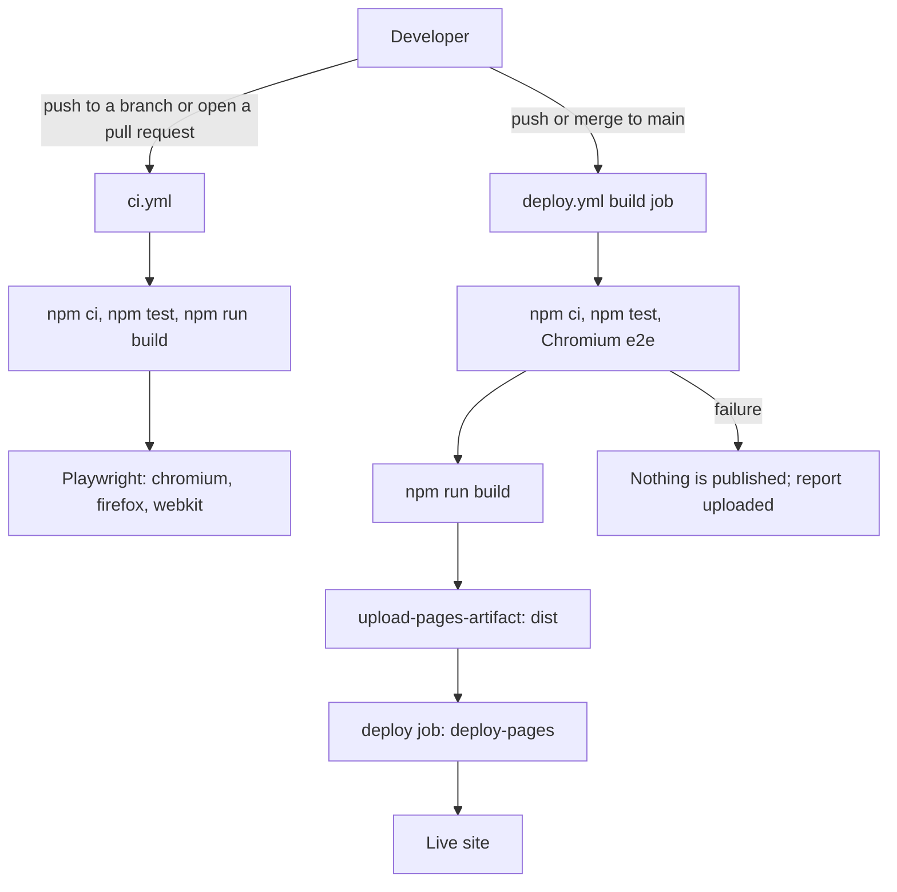

# GitHub Actions

[Wiki home](../README.md) · [Deployment overview](deployment-overview.md)

## Pipeline

## Workflows

| File | Triggers | Does | Permissions |
|---|---|---|---|
| [`ci.yml`](../../../.github/workflows/ci.yml) | Pull requests; pushes to non-`main` branches; manual | Tests, build, e2e on three browsers; never deploys | `contents: read` |
| [`deploy.yml`](../../../.github/workflows/deploy.yml) | Push to `main`; manual | Tests, Chromium e2e, build, publish | `contents: read`, `pages: write`, `id-token: write` |

- Node 22 with npm caching.
- `deploy.yml` runs one deployment at a time and does not cancel one in progress. `ci.yml` cancels superseded runs of the same ref.
- Failed e2e runs upload `playwright-report/` and `test-results/` for 7 days.
- Actions are pinned to major tags (for example `actions/checkout@v4`), not commit hashes. CI logs have warned that some run on a deprecated Node version.

Note: the e2e step builds the app itself, and `deploy.yml` builds again afterwards for the published artifact.

Firefox and WebKit are checked only by `ci.yml`. A direct push to `main` is gated on Chromium alone.
