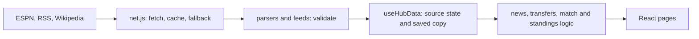

# Arsenal Hub wiki

Arsenal Hub is an unofficial Arsenal fan site: match day, news with source credibility, transfers, squads, comparison and history. It is a React single-page app with no backend, hosted on GitHub Pages.

- Live site: <https://mushahidur-lgtm.github.io/arsenal-hub/>
- Repository: <https://github.com/mushahidur-lgtm/arsenal-hub>
- Documented against commit `2cd40e2` (November 2026)

## Start here

| If you want to… | Read |
|---|---|
| Understand the project | [Project overview](01-overview/project-overview.md) |
| Use the site | [User guide](01-overview/user-guide.md) |
| Run it locally | [Prerequisites](05-development/prerequisites.md) → [Local setup](05-development/local-setup.md) |
| Understand how it works | [System architecture](02-architecture/system-architecture.md) → [Data flow](02-architecture/data-flow.md) |
| Add something | [Adding a feature](05-development/adding-a-feature.md) |
| Fix something | [Troubleshooting](05-development/troubleshooting.md) |
| Release | [Release process](06-deployment-and-operations/release-process.md) |

## Architecture at a glance

## Contents

**1. Overview** — [Project overview](01-overview/project-overview.md) · [Features and capabilities](01-overview/features-and-capabilities.md) · [User guide](01-overview/user-guide.md) · [Roadmap](01-overview/roadmap.md)

**2. Architecture** — [System](02-architecture/system-architecture.md) · [Application structure](02-architecture/application-structure.md) · [Components](02-architecture/component-architecture.md) · [Routing](02-architecture/routing-and-navigation.md) · [Data flow](02-architecture/data-flow.md) · [Design system](02-architecture/design-system.md)

**3. Features** — [Dashboard](03-features/dashboard.md) · [Fixtures and results](03-features/fixtures-and-results.md) · [League and standings](03-features/league-and-standings.md) · [Squad and players](03-features/squad-and-players.md) · [Statistics and comparison](03-features/statistics.md) · [News](03-features/news-and-content.md) · [Transfers](03-features/transfers.md) · [History](03-features/history.md) · [Other features](03-features/other-features.md)

**4. Data and integrations (API reference)** — [Data sources](04-data-and-integrations/data-sources.md) · [API reference](04-data-and-integrations/api-reference.md) · [Data models](04-data-and-integrations/data-models.md) · [Transformation](04-data-and-integrations/data-transformation.md) · [Caching and refresh](04-data-and-integrations/caching-and-refresh.md) · [Error handling](04-data-and-integrations/error-handling.md)

**5. Development** — [Prerequisites](05-development/prerequisites.md) · [Local setup](05-development/local-setup.md) · [Project structure](05-development/project-structure.md) · [Coding conventions](05-development/coding-conventions.md) · [Adding a feature](05-development/adding-a-feature.md) · [Testing](05-development/testing.md) · [Troubleshooting](05-development/troubleshooting.md)

**6. Deployment and operations** — [Overview](06-deployment-and-operations/deployment-overview.md) · [GitHub Pages](06-deployment-and-operations/github-pages.md) · [GitHub Actions](06-deployment-and-operations/github-actions.md) · [Environment](06-deployment-and-operations/environment-configuration.md) · [Release process](06-deployment-and-operations/release-process.md)

**7. Quality and security** — [Code quality](07-quality-and-security/code-quality.md) · [Accessibility](07-quality-and-security/accessibility.md) · [Performance](07-quality-and-security/performance.md) · [Security](07-quality-and-security/security.md) · [Known limitations](07-quality-and-security/known-limitations.md)

**8. Reference** — [Glossary](08-reference/glossary.md) · [Dependencies](08-reference/dependencies.md) · [Configuration](08-reference/configuration-reference.md) · [File and component index](08-reference/file-and-component-index.md)

**9. Claude Code prompts** — [Prompt library](09-claude-prompts/README.md) (kept apart from the technical documentation)

## Maintaining this wiki

- Update the page in the same change as the behaviour it describes.
- State what is verified and what is not.
- Never include keys, tokens, personal data or secret values.

### Publishing to GitHub Wiki later

This folder is the single source. GitHub Wiki is a separate Git repository (`arsenal-hub.wiki.git`) with a flat page namespace, so publishing means copying the pages there, giving them unique names (both this page and the prompt index are `README.md`), turning this page into `Home.md`, and rewriting relative links. If that becomes worthwhile, automate it from this folder rather than editing two copies.
